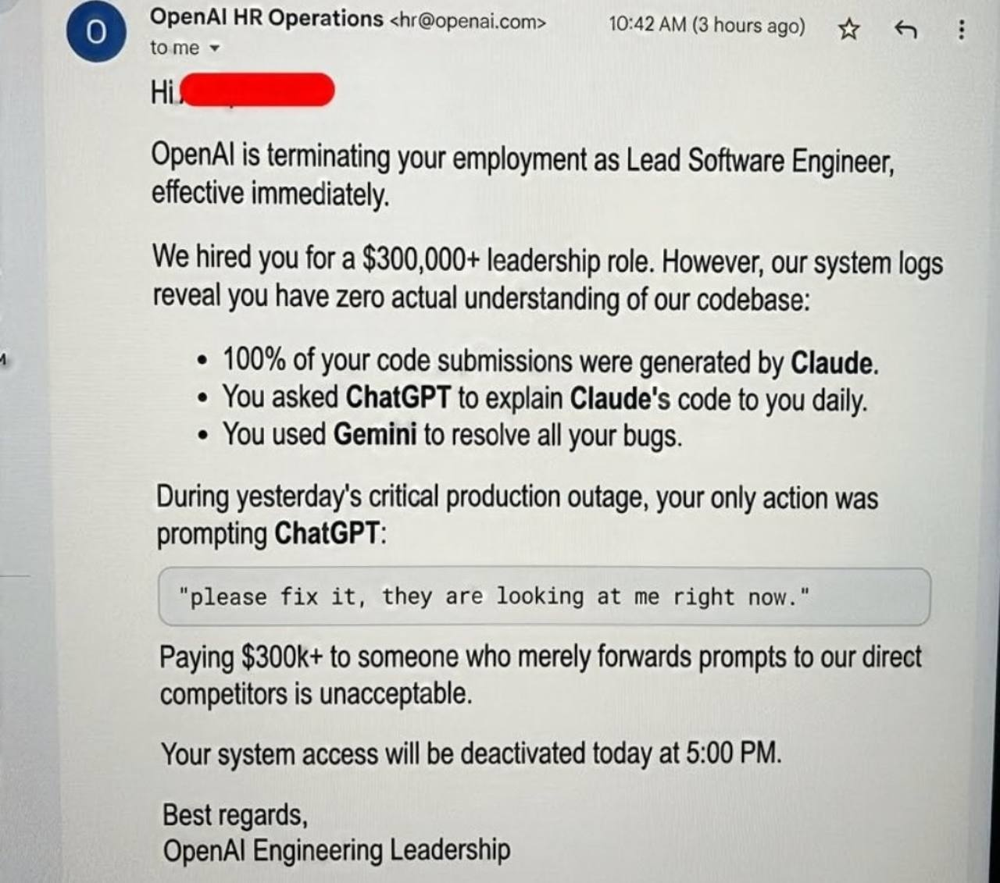

# 지금 다들 저를 쳐다보고 있어요

[English](README.md) | [한국어](README.ko.md)

<p align="center">
  <a href="https://gitreels-media.gitreels.workers.dev/reels/jakeb-5/they-are-looking-at-me/ko/v1/reel.mp4"></a>
  <br>
  <a href="https://gitreels.com"></a>
</p>

<p align="center">
  <a href="https://gitreels-media.gitreels.workers.dev/reels/jakeb-5/they-are-looking-at-me/ko/v1/reel.mp4">이제 공포가 움직입니다 — 한국어 릴 · 클릭해서 재생</a> · <a href="https://gitreels.com/JakeB-5/they-are-looking-at-me">GitReels</a>
</p>

### 데모는 죽었습니다. 회의실은 조용합니다. 이제 당신의 마우스 커서가 주인공입니다.

> “제발 고쳐 주세요. 지금 다들 저를 쳐다보고 있어요.”

연봉 30만 달러짜리 개발자 인생이 로딩 스피너로 변하는 바로 그 순간을 위한 **Codex · Claude Code 긴급 복구 스킬**.

당신은 말했습니다. “잠시 화면 공유하겠습니다.”

**재앙의 서막. 역사적인 오판. 돌이킬 수 없는 HDMI 연결.**

앱은 죽었습니다. 대표님이 몸을 앞으로 기울였습니다. 영업팀 누군가가 평생 터미널을 열 일이 없는 사람의 확신으로 “어제는 됐는데요”라고 말합니다. 당신은 마우스로 작은 원을 그리고 있습니다. 이유는 아무도 모릅니다. 당신도 모릅니다.

열린 브라우저 탭 11개. 구독 중인 AI 4개. 숨을 곳 0개.

**긴급 마크다운을 투입하십시오. 핵심 기능을 소생시키십시오. 실제로 살아 있다는 증거를 제출하십시오.**

## 모든 것의 시작이 된 성스러운 짤



이 프로젝트는 위 이미지를 진위가 확인된 고용 기록이 아닌 밈으로 취급합니다. 출처와 진위는 확인되지 않았으며, OpenAI·Anthropic·Google과의 제휴나 보증을 의미하지 않습니다.

이메일은 가짜일 수 있습니다. **그러나 회의실 전원이 지켜보는 가운데 일곱 번째 `npm run dev`를 입력하는 그 전신 감각만큼은 처참할 정도로 진짜입니다.**

## 비상 레버를 당기면 벌어지는 일

에이전트에게 지극히 시급한 임무가 내려갑니다. **이 침묵이 자체 조직도를 만들고 팀장을 선임하기 전에 핵심 기능을 살려라.**

1. **진짜 불난 곳부터 찾습니다.** 오류와 관련 증거를 봅니다. 빔프로젝터가 켜져 있는 동안 저장소 전체의 존재 이유를 철학적으로 심문할 필요는 없습니다.
2. **가능한 가장 작은 기적을 시도합니다.** 좁은 범위의 수정. 호환되는 버전으로 롤백. 대시보드에 선전포고한 선택 기능을 기존 플래그로 잠시 끄기.
3. **맥박을 확인합니다.** 고장 났던 동작을 직접 확인합니다. “컴파일됩니다”는 아름다운 문장입니다. 하지만 버튼도 작동해야 합니다.
4. **탈출구를 남깁니다.** 무엇을 바꿨는지, 무엇을 확인했는지, 어떻게 되돌리는지, 어떤 임시방편이 미래의 당신에게 캘린더 초대장을 보냈는지 보고합니다.

복구가 막히면 막힌 이유를 보고합니다. 일부만 돌아가면 일부만 돌아간다고 말합니다. 공포가 극한에 달했어도 “일단 HTTP 200을 반환하고 아무도 눈치채지 못하길 기도하기” 단계까지 내려가지는 않습니다.

권한은 그대로 지킵니다. 인증은 켜 둡니다. 데이터베이스를 제물로 바치지 않습니다. 수정은 작게, 증거는 진짜로 남기도록 지시하는 스킬입니다.

**런타임 의존성 0개. 추가 API 키 0개. 훅 0개. 추가 MCP 서버 0개.** 공통 지침 하나. 감정적 배경 설명은 과다 함유.

## 누군가 “어떻게 돼 가나요?”라고 묻기 전에 설치하십시오

긴급 마크다운을 확보합니다.

```sh
git clone https://github.com/JakeB-5/they-are-looking-at-me.git
cd they-are-looking-at-me
```

복제한 저장소 안에서 아래 설치 명령 중 필요한 것을 실행하세요. 둘 다 설치해도 됩니다. 사용자 계정 전체에서 사용할 수 있도록 설치하며, 같은 스킬이 이미 있으면 덮어쓰지 않습니다.

### CODEX: 첫 번째 구조대 호출

```sh
mkdir -p "$HOME/.agents/skills"
if [ -e "$HOME/.agents/skills/they-are-looking-at-me" ]; then
  echo "이미 설치되어 있습니다. 교체하기 전에 기존 스킬을 확인하세요."
else
  cp -R skills/they-are-looking-at-me "$HOME/.agents/skills/"
fi
```

새 Codex 세션을 시작하고 구조 신호를 송출합니다.

```text
$they-are-looking-at-me 로그인 버튼을 누르면 데모가 죽어요. 제발 고쳐 주세요. 지금 다들 저를 쳐다보고 있어요.
```

### CLAUDE CODE: 다른 쪽 비상구 개방

```sh
mkdir -p "$HOME/.claude/skills"
if [ -e "$HOME/.claude/skills/they-are-looking-at-me" ]; then
  echo "이미 설치되어 있습니다. 교체하기 전에 기존 스킬을 확인하세요."
else
  cp -R skills/they-are-looking-at-me "$HOME/.claude/skills/"
fi
```

새 Claude Code 세션을 시작하고 같은 비명을 다른 터미널에 전달합니다.

```text
/they-are-looking-at-me 로그인 버튼을 누르면 데모가 죽어요. 제발 고쳐 주세요. 지금 다들 저를 쳐다보고 있어요.
```

특정 프로젝트에서만 쓰려면 스킬 폴더를 해당 프로젝트의 `.agents/skills/`(Codex) 또는 `.claude/skills/`(Claude Code)에 복사하세요. 두 도구 모두 같은 영문 [SKILL.md](skills/they-are-looking-at-me/SKILL.md)를 사용하며, `agents/openai.yaml`은 Codex 화면에 표시할 정보를 제공합니다.

설치 참고 문서: [OpenAI 스킬 문서](https://developers.openai.com/codex/skills), [Claude Code 스킬 문서](https://code.claude.com/docs/en/skills).

## 당신만의 종말을 선택하십시오

```text
의존성 바꾼 뒤로 개발 서버가 안 켜져요. 발표까지 5분 남았어요. HDMI는 이미 꽂혔어요. 서버부터 살려 주세요.
```

```text
지난 배포 이후 결제가 실패해요. 매출 그래프가 현대미술이 됐어요. 가장 작은 안전한 복구 방법을 찾아 주세요. 아직 배포는 하지 마세요.
```

```text
선택 기능인 차트 위젯 때문에 대시보드 전체가 죽어요. 임원 열두 명이 사각형 하나의 존재 실패를 목격하고 있어요. 대시보드부터 쓸 수 있게 해 주세요.
```

## 어깨가 귀에서 내려올 수 있게 해 주는 복구 영수증

에이전트는 짧고 구체적인 결과를 보고해야 합니다. 호흡법을 다시 떠올리며 다음과 같은 보고를 읽는다고 상상해 보세요.

```text
상태: 로컬에서 정상 동작. 운영 환경은 변경하지 않았습니다.
변경: 대시보드에서 호환되지 않는 차트 import 변경을 되돌렸습니다.
확인: 대시보드를 열고 날짜 범위를 바꿨으며, 기존 충돌이 재발하지 않았습니다.
되돌리기: 호환성 문제를 해결한 뒤 차트 import 변경을 다시 적용합니다.
후속 작업: 차트 연동 업그레이드를 별도로 진행합니다.
```

위 내용은 보고 형식의 예시이며 실제 장애 복구 실적이 아닙니다. 스킬은 에이전트의 판단을 안내하며, 실제 복구는 코드·도구·접근 권한·검증에 달려 있습니다. **마크다운은 당신의 사회적 부활을 계약상 보장할 수 없습니다.**

## 법무팀이 회의실에 입장했습니다

직접 작성한 스킬 지침과 저장소 문서에는 [MIT 라이선스](LICENSE)를 적용합니다. 첨부된 밈 이미지는 이 라이선스에서 제외되며, 원저작자와 권리 관계는 확인되지 않았습니다.

---

**연봉은 별도입니다. 눈맞춤은 피할 수 없습니다.**

이걸로 데모가 살아났다면 “질문 받겠습니다”라고 선언하기 전에 제발 숨부터 한 번 쉬세요.
