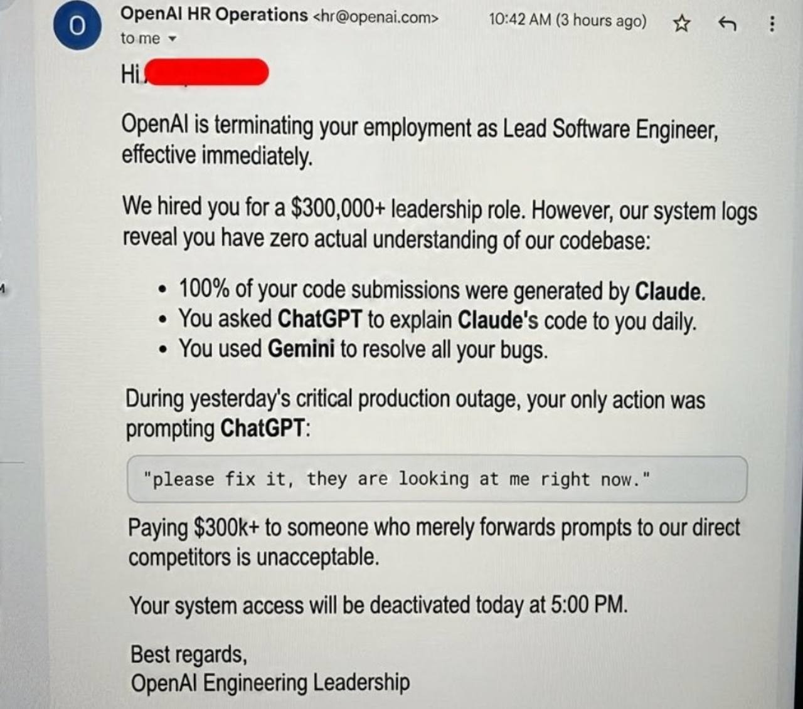

# They Are Looking at Me

> "please fix it, they are looking at me right now."

An emergency recovery skill for **Codex** and **Claude Code**.

For when the demo is broken, the app won't start, and your audience has developed an intense interest in your terminal.

**Make the critical path work. Verify it. Explain the temporary mess later.**

## The origin story



This project treats the supplied screenshot as a meme, not an authenticated employment record. Its origin and authenticity are unverified. No affiliation with or endorsement by OpenAI, Anthropic, or Google is implied.

The email may be fake. The feeling is familiar.

## What it does

The skill steers your coding agent toward a small, reversible recovery: inspect the immediate failure, choose a plausible fix or rollback, apply it, and exercise the path that was broken. If full recovery is out of reach, it reports the actual blocker or an honest degraded state.

It keeps temporary workarounds visible and leaves a way to undo the change. It does not grant extra permissions, bypass security, or turn a failed request into a pretend success.

No runtime dependencies, API keys, hooks, or extra MCP servers. Just one shared instruction set for both agents.

## Install

Clone this repository once:

```sh
git clone https://github.com/JakeB-5/they-are-looking-at-me.git
cd they-are-looking-at-me
```

Run either or both installation blocks from the cloned repository. They install for your user account and stop if that skill already exists, so a previous installation is not silently overwritten.

### Codex

```sh
mkdir -p "$HOME/.agents/skills"
if [ -e "$HOME/.agents/skills/they-are-looking-at-me" ]; then
  echo "Already installed; review the existing skill before replacing it."
else
  cp -R skills/they-are-looking-at-me "$HOME/.agents/skills/"
fi
```

Start a new Codex session and invoke:

```text
$they-are-looking-at-me The demo crashes when I click Sign in. Please fix it, they are looking at me right now.
```

### Claude Code

```sh
mkdir -p "$HOME/.claude/skills"
if [ -e "$HOME/.claude/skills/they-are-looking-at-me" ]; then
  echo "Already installed; review the existing skill before replacing it."
else
  cp -R skills/they-are-looking-at-me "$HOME/.claude/skills/"
fi
```

Start a new Claude Code session and invoke:

```text
/they-are-looking-at-me The demo crashes when I click Sign in. Please fix it, they are looking at me right now.
```

For a project-only installation, copy the skill folder into your target project's `.agents/skills/` for Codex or `.claude/skills/` for Claude Code instead. Both use the same [SKILL.md](skills/they-are-looking-at-me/SKILL.md); `agents/openai.yaml` supplies Codex display metadata.

Installation references: [OpenAI skills documentation](https://developers.openai.com/codex/skills) and [Claude Code skills documentation](https://code.claude.com/docs/en/skills).

## Typical requests

```text
The dev server stopped starting after the last dependency change. I present in five minutes.
```

```text
Checkout started failing after the last release. Find the smallest safe recovery. Do not deploy yet.
```

```text
The optional chart widget crashes the entire dashboard. Get the dashboard usable again.
```

The agent should return something concrete:

```text
Status: Working locally; production has not been changed.
Changed: Reverted the incompatible chart import in the dashboard.
Verified: Opened the dashboard and switched date ranges without the original crash.
Undo: Reapply the chart import change after fixing compatibility.
Later: Upgrade the chart integration separately.
```

That is an illustrative report, not a claim that this repository repaired an incident. A skill guides an agent's decisions; recovery still depends on the code, available tools, access, and verification.

## License

The original skill instructions and repository text are [MIT licensed](LICENSE). The supplied meme image is excluded from that license; its original authorship and rights are unknown.

Salary not included. Eye contact unavoidable.
